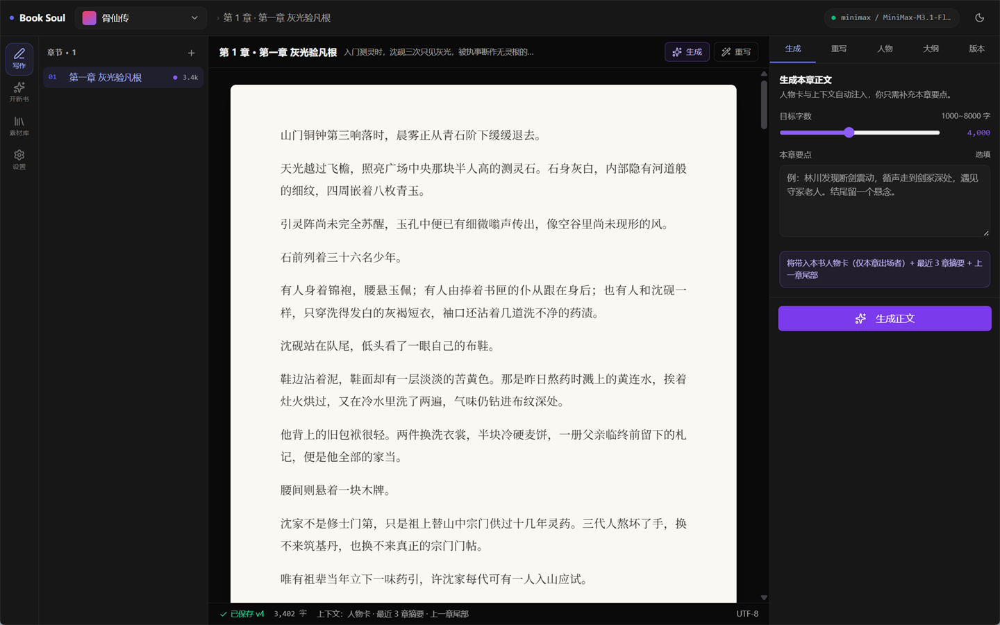
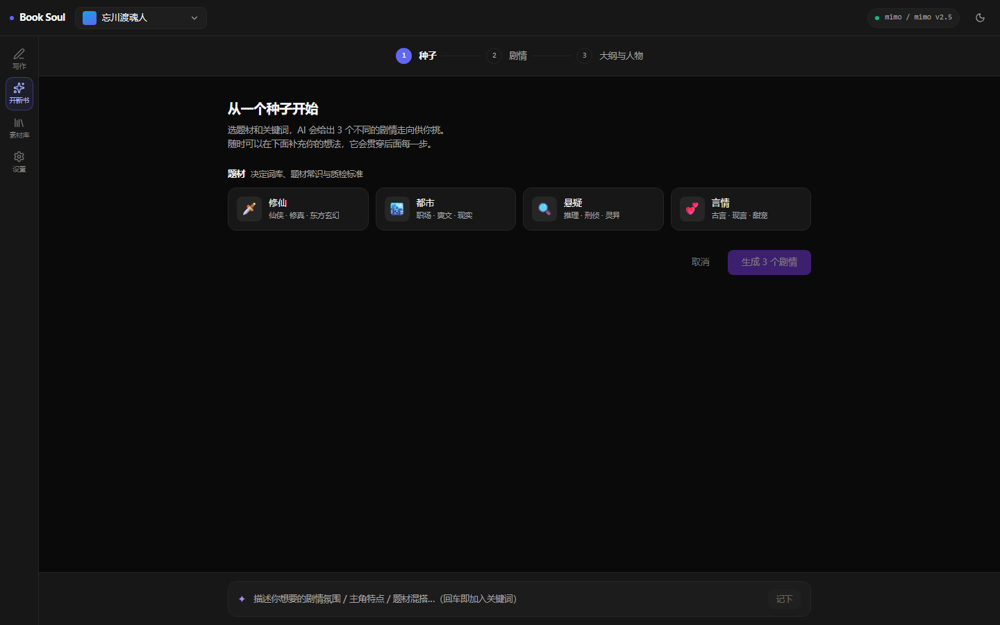
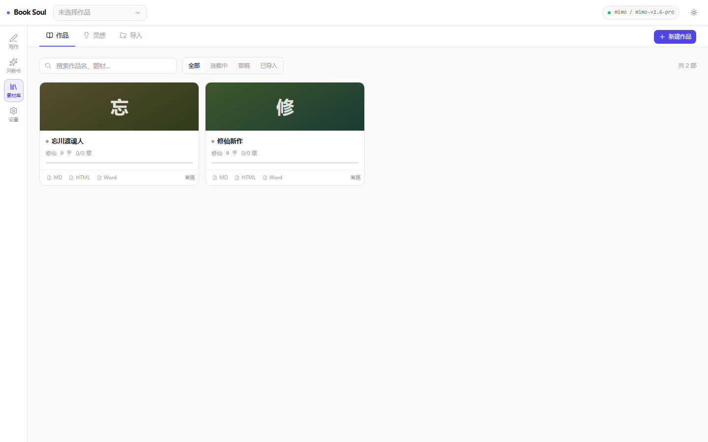
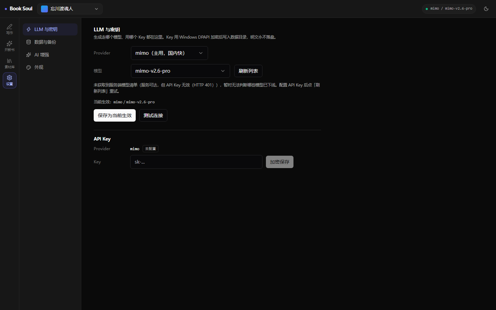

# Book Soul

> 小说 AI 写作桌面应用 · 人物卡驱动的本地优先创作工具

[](LICENSE)
[](https://www.python.org/)
[](https://react.dev/)
[](https://tauri.app/)
[](server/tests)

<p align="center">
  
  
</p>
<p align="center">
  
  
</p>

## 项目简介

Book Soul 是一款为网文作者和严肃文学作者设计的 **AI 辅助写作桌面应用**。
从灵感发现、人物设定、大纲生成到章节创作与版本回滚，提供完整创作闭环。

**本地优先**：数据全部存在你自己机器上的 SQLite 文件里，不依赖任何云端账号体系。

### 核心特色

- 🎭 **人物卡驱动一致性** —— 所有创作严格按人物卡走（性格 / 习惯 / 思维 / 关系 / 成长弧线），AI 不会写出 OOC 的角色
- 📐 **正文自动排版** —— 模型不输出段落时自动兜底断段，汉字间多余空格清掉，连续对白自动拆段；字数按**非空白字符数**统计，与 Word 一致（不会出现「提示 5338 字 / 实际 3309 字」）
- 🛠 **Skill 工具箱** —— 内置 12 个技能（字数统计 / 敏感词检查 / 章节摘要 / 角色抽取 / 题材分类 / 一致性检查 …），支持用户自定义扩展
- 🤖 **双模式 LLM** —— 云端（mimo / MiniMax / OpenAI 等任何 OpenAI 兼容端点）+ 本地（Ollama），按场景独立路由
- 🔒 **密钥零明文** —— API Key 优先级：环境变量 > DPAPI 加密文件 > 系统 Keyring；打包版不含 `.env`
- ✍️ **流式创作** —— 章节生成、选区重写、大纲补全全部实时流式输出，配合 Tiptap 富文本编辑器
- 📚 **作品名唯一** —— 同一时间只能有一本同名作品（重名自动加序号），素材库里作品可**手动排序**、右键重命名 / 删除 / 导出
- 🔄 **版本控制** —— 每次修改自动存版本，diff 视图对比，秒级回滚（回滚本身也生成新版本，审计链完整）
- 📤 **多格式导出** —— Markdown / HTML / Word（.docx）/ 完整备份 zip
- 🔍 **本地扫描** —— 一键扫描本地小说目录批量导入，自动识别作品与章节
- 📦 **双击即用** —— Tauri 桌面应用，自带 Python 后端 sidecar，不装 Python / Node / Rust 也能跑

### 界面结构（4 个一级页面）

| 页面 | 路由 | 内容 |
|---|---|---|
| ✍️ **写作** | `/` | 三栏：章节树 244px \| 纸感编辑区 \| 上下文面板 332px（右栏 5 Tab：生成 / 重写 / 人物 / 大纲 / 版本） |
| 🆕 **开新书** | `/new` | 三步向导：种子 → 剧情 → 大纲与人物（第 1 步可**自己起书名**，重名自动加序号） |
| 📚 **素材库** | `/library` | 三 Tab：作品 / 灵感 / 导入（作品卡支持右键菜单：重命名 / 删除 / 上移下移 / 导出；列表可排序） |
| ⚙️ **设置** | `/settings` | 四分区：LLM 与密钥 / 数据与备份 / AI 增强 / 外观 |

> 人物卡、大纲、版本都是「当前章节的上下文」，不是独立页面 —— 全部收在写作页右栏。
> 设计决策与视觉规范见 [docs/DESIGN.md](./docs/DESIGN.md)。

---

## 快速启动

### 方式 A · 独立版（推荐给普通用户）

**不需要**装 Python / Node / Rust，**不需要**开终端，**不会**弹黑色控制台。

1. 前往 [Releases](https://github.com/jeezee990-arch/book-soul/releases) 下载 `Book Soul_0.1.0_x64-setup.exe`
2. 双击安装 → 开始菜单和桌面会出现 "Book Soul" 图标
3. 启动后在 **设置 → LLM 与密钥** 填入 API Key（推荐 mimo，国内直连免 VPN）
4. 进 **开新书** 页，走三步流程：种子 → 剧情 → 大纲与人物

> 安装模式是 `currentUser`，装到你的用户目录（不写 `Program Files`，避免只读导致数据写不进去）。

### 方式 B · 开发模式（改代码时用）

**环境要求**

| 工具 | 版本 | 说明 |
|---|---|---|
| Python | ≥ 3.11 | 后端运行时 |
| [uv](https://docs.astral.sh/uv/) | ≥ 0.4 | Python 包管理（**不要用 pip / poetry**） |
| Node.js | ≥ 20 | 前端构建 |
| pnpm | ≥ 9 | Node 包管理（**不要用 npm / yarn**） |
| Rust | ≥ 1.74 | Tauri 2 壳 |
| Tauri 系统依赖 | Linux 必需 | `libwebkit2gtk-4.1-dev libgtk-3-dev libayatana-appindicator3-dev librsvg2-dev patchelf` |

**安装依赖**

```bash
git clone https://github.com/jeezee990-arch/book-soul.git
cd book-soul

# 后端 —— 根 pyproject.toml 是 uv workspace（members = ["server"]），
# venv 统一落在**仓库根的 .venv/**，所以在根目录执行
uv sync

# 前端
cd apps/desktop && pnpm install && cd ../..
```

> `dev.ps1` / `build_standalone.ps1` 都硬编码用 `<仓库根>\.venv\Scripts\python.exe`，
> 所以 venv 位置必须是仓库根 —— 这也是为什么要 `uv sync` 而不是在 `server/` 里单独建 venv。

**启动**

```powershell
# 一键（带可见控制台，能看后端日志）
powershell -ExecutionPolicy Bypass -File scripts\dev.ps1

# 零控制台（优先跑已打包的独立版，没有则退回开发模式）
wscript.exe scripts\launcher.vbs
```

也可以手动分两个终端：

```bash
# 终端 1：后端（127.0.0.1:8765）
cd server && uv run python -m src.main

# 终端 2：前端 + Tauri 壳（Vite 在 127.0.0.1:5173）
cd apps/desktop && pnpm tauri dev
```

> `pnpm tauri dev` 一条命令就够了 —— Tauri 的 `beforeDevCommand` 会先拉起 Python 后端并等 `/ping` 就绪，再起 Vite。
> 端口不用手工管：Rust 侧优先复用 8765 上「本项目」的后端，没有就自己分配随机空闲端口并下发给前端。

**常用命令**

```bash
# 后端测试（781 个用例）
cd server && uv run pytest -q --cov=src --cov-report=term-missing

# 前端测试（275 个用例）
cd apps/desktop && pnpm test

# 代码质量
cd server && uv run ruff check .
cd apps/desktop && pnpm build
cd apps/desktop/src-tauri && cargo check
```

### 方式 C · 构建独立版

```powershell
powershell -ExecutionPolicy Bypass -File scripts\build_standalone.ps1
```

产物落在 `dist\Book Soul\`：

```
dist\Book Soul\
├── Book Soul.exe          ← 双击这个（4.6 MB）
├── book-soul-server.exe   ← Python 后端 sidecar（31 MB，应用自动拉起）
├── data\                  ← 运行时数据（数据库 / 密钥 / 日志）
└── README.txt
```

整个文件夹拷到任何地方都能跑 —— **便携模式**：数据写在 exe 同级的 `data\`，不写注册表，不依赖仓库。

> ⚠️ **重建不会动 `data\`** —— 你的数据库、API Key、日志都留在原地。
> 首次构建约 5-8 分钟（Rust release 编译最慢），之后约 1-2 分钟。
> ⚠️ **改完前端必须重新打包** —— Tauri 把前端资源嵌进了 exe 二进制，`pnpm dev` / `vite build` 都不会更新已生成的 exe。

**装桌面快捷方式**

```powershell
powershell -ExecutionPolicy Bypass -File scripts\install_shortcut.ps1   # 装
powershell -ExecutionPolicy Bypass -File scripts\uninstall_shortcut.ps1 # 卸
```

---

## 项目结构

```
book-soul/
├── apps/desktop/                    # Tauri 2 桌面壳 + React 前端
│   ├── src/
│   │   ├── App.tsx                  # 路由表（HashRouter，4 个一级页面）
│   │   ├── components/              # 通用组件
│   │   │   ├── layout/              # 应用外壳（52px 顶栏 / 56px 图标栏）
│   │   │   ├── ui/                  # shadcn/ui 原子组件
│   │   │   ├── novel-switcher.tsx   # 全局作品切换器（唯一入口）
│   │   │   ├── model-status-pill.tsx# 顶栏模型状态灯
│   │   │   └── ...                  # DiffViewer / CharacterCard / ErrorBoundary ...
│   │   ├── pages/                   # 4 个一级页面
│   │   │   ├── Writing/             # 写作（index + 5 个右栏 Tab + 流式 hook）
│   │   │   ├── NewBook/             # 开新书三步向导（含 3 个流式 hook + 书名输入）
│   │   │   ├── Library/             # 素材库（作品 / 灵感 / 导入）
│   │   │   │   │                   #   + NovelCard / NovelContextMenu / novel-sort
│   │   │   └── Settings/            # 设置（4 个分区）
│   │   ├── api/                     # 后端 API 的 TS 客户端（16 个模块）
│   │   │   ├── backend.ts           # 后端地址解析 + 就绪握手
│   │   │   ├── streams.ts           # NDJSON 流读取 + 失败检测
│   │   │   └── ...                  # chapters / characters / outlines / llm / ...
│   │   ├── stores/                  # Zustand（7 个 store）
│   │   │   └── workspace-store.ts   # 当前作品（全局唯一状态）
│   │   ├── lib/                     # 纯函数工具 + 类型（10 个）
│   │   │   ├── prose-text.ts        # 段落切分 + 真实字数（口径与后端一致）
│   │   │   ├── prose-insert.ts      # ProseMirror 流式插入（不碰 DOM）
│   │   │   ├── novel-name.ts        # 作品命名规则（前后端共用）
│   │   │   └── ...                  # auto-scroll / consistency / outline-merge ...
│   │   └── styles.css               # 全局样式（含 .novel-paper 纸面）
│   ├── scripts/                     # 前端自证脚本（Node 直接跑，import 生产实现）
│   │   ├── verify-append.mjs        # 流式插入自证
│   │   └── repro-append.mjs         # 插入行为复现
│   └── src-tauri/                   # Rust 桌面壳
│       ├── src/
│       │   ├── main.rs              # 入口
│       │   ├── lib.rs               # Tauri command / 窗口事件 / 应用装配
│       │   ├── sidecar.rs           # 后端定位与拉起（随机端口 / 数据目录）
│       │   └── logging.rs           # 桌面端日志（release 无控制台）
│       ├── tauri.conf.json          # 窗口 / 打包 / sidecar 配置
│       └── Cargo.toml
│
├── server/                          # FastAPI 后端
│   ├── src/
│   │   ├── api/                     # 路由层（16 个模块，只做依赖注入 + 错误映射）
│   │   ├── services/                # 业务逻辑（26 个模块）
│   │   ├── models/                  # SQLAlchemy 2 ORM（7 张业务表）
│   │   ├── schemas/                 # Pydantic 契约（7 个模块）
│   │   ├── core/                    # 基础设施
│   │   │   ├── llm/                 # LLM 抽象（base / factory / openai_compat / ollama
│   │   │   │                        #   + streaming / thinking / cache / partial_json）
│   │   │   ├── skills/              # Skill 系统（base / registry / manager / loader + builtin×12）
│   │   │   ├── security/            # dpapi / secret_store / encryption / keyring_manager
│   │   │   ├── scanner/             # 本地小说扫描与导入
│   │   │   ├── versioning/          # 版本树 + diff
│   │   │   ├── chapter_context.py   # 章节上下文组装（人物卡 → prompt）
│   │   │   ├── prose_format.py      # ★ 正文排版器（兜底断段 / 去空格 / 连续对白拆段）
│   │   │   ├── queue_merge.py       # 多版本流合并（内容实时 + 里程碑保序）
│   │   │   ├── paths.py             # 路径解析统一入口（开发态 / 打包态）
│   │   │   └── watchdog.py          # 父进程看门狗
│   │   ├── db.py                    # async engine + 外键约束 + schema 自愈
│   │   └── main.py                  # 应用装配 + CLI
│   ├── tests/                       # 781 个 pytest 用例
│   ├── book_soul.spec               # PyInstaller 打包配置
│   ├── run_server.py                # 打包入口（绝对 import）
│   └── pyproject.toml
│
├── config/                          # 运行时配置（全部进包）
│   ├── llm.yaml                     # provider 配置 + 场景路由 + 模型规格
│   ├── app.yaml                     # 用户级默认配置
│   ├── prompts/                     # 8 个提示词 YAML（按场景拆分）
│   ├── genres/                      # 题材常识（修仙 / 都市 / 悬疑 / 言情）
│   ├── wordbanks/                   # 题材词库（按板块分文件）
│   ├── skills/                      # 用户自定义 Skill
│   └── skill_template/              # Skill 脚手架
│
├── scripts/                         # 构建与启动脚本（PowerShell，必须 UTF-8 BOM）
│   ├── dev.ps1                      # 开发模式启动器（可见控制台）
│   ├── launcher.vbs / launcher_hidden.ps1  # 零控制台启动（优先独立版）
│   ├── build_standalone.ps1         # 一键出独立版 → dist\Book Soul\
│   ├── build_sidecar.ps1            # PyInstaller 打后端 sidecar
│   ├── install_shortcut.ps1 / uninstall_shortcut.ps1
│   ├── mock_provider.py             # 无 API Key 也能走完「开新书」三步
│   └── repair_chapter_paragraphs.py # 修复历史章节被假段落破坏的排版
││
├── docs/                            # 文档
│   ├── DESIGN.md                    # 界面设计规范（信息架构 + 视觉规范）
│   ├── PROJECT_STRUCTURE.md         # 项目结构详解（目录职责 + 数据流）
│   ├── START_GUIDE.md               # 启动方式 + 人工验证清单
│   ├── USER_GUIDE.md                # 功能使用说明
│   ├── TROUBLESHOOTING.md           # 排障与应急手册
│   ├── ARCHITECTURE.md              # 架构设计 / 数据模型 / 关键决策
│   ├── API.md                       # 后端 API 参考
│   ├── SKILLS.md                    # Skill 系统说明
│   └── screenshots/                 # 真机截图
│
├── pyproject.toml                   # uv workspace 根（members = ["server"]）
├── uv.lock                          # Python 依赖锁定
├── AGENTS.md                        # 技术规范（强制）
├── DEVELOPMENT_CONSTRAINTS.md       # 行为约束（沟通 / 流程 / 决策）
├── PROJECT_PLAN.md                  # 项目计划书（历史快照 + 决策记录）
├── SECURITY.md                      # 安全策略
├── data/                            # 运行时数据（不入 git）
├── dist/Book Soul/                  # 独立版产物（便携目录，gitignore）
└── .github/workflows/               # ci.yml / release.yml
```

### 分层铁律

- 业务逻辑在 `services/`，API 路由只做依赖注入 + 错误映射
- DB 操作走 `models/`，service 不写原生 SQL
- 文件 IO 集中在 service 层
- LLM 抽象在 `core/llm/`，业务代码不直接 import httpx / 任何 LLM SDK
- 路径解析统一走 `core/paths.py`（处理 PyInstaller 的 `sys._MEIPASS`），禁止再写 `_find_repo_root()`
- 前端不硬编码后端地址 —— 端口由 Rust 侧分配后下发

---

## 技术栈

| 层级 | 技术 |
|---|---|
| 桌面壳 | Tauri 2（Rust） |
| 前端 | React 18 + TypeScript + Vite + Tailwind CSS + shadcn/ui |
| 编辑器 | Tiptap 3 |
| 状态管理 | Zustand |
| 后端 | Python 3.11+ + FastAPI（async） |
| ORM / 数据库 | SQLAlchemy 2 + SQLite（aiosqlite，外键约束已开启） |
| LLM 抽象 | 自研 Protocol（~200 行），不用 LangChain / LlamaIndex |
| 打包 | PyInstaller（后端 sidecar）+ Tauri bundler（应用壳） |
| 包管理 | uv（Python）/ pnpm（Node） |
| 测试 | pytest 781 + vitest 275 = **1056 个用例** |
| CI | GitHub Actions（backend / frontend / packaging-smoke） |

> **没有 ChromaDB / 向量库** —— 早期设计里的 RAG 已移除：个人网文收益低（要 50+ 章才体现）、
> 负担重（embedding 依赖 + 向量库 + 检索调优）。当前用「人物卡 + 最近 3 章摘要 + 上一章尾部」的滑动窗口。

---

## 文档

| 文档 | 适合谁 |
|---|---|
| [快速开始（本文档）](#快速启动) | 第一次上手 |
| [界面设计规范](docs/DESIGN.md) | 改 UI 前必读 —— 信息架构 + 视觉令牌 |
| [项目结构详解](docs/PROJECT_STRUCTURE.md) | 想知道每个目录干什么、数据怎么流 |
| [启动指南 + 人工验证清单](docs/START_GUIDE.md) | 装完怎么逐步验证 |
| [排障与应急手册](docs/TROUBLESHOOTING.md) | 出问题了查这里 |
| [用户指南](docs/USER_GUIDE.md) | 各功能怎么用 |
| [架构设计](docs/ARCHITECTURE.md) | 模块划分 / 数据模型 / 关键设计决策 |
| [API 参考](docs/API.md) | 后端所有端点 |
| [Skill 系统](docs/SKILLS.md) | 内置技能与自定义 Skill 写法 |
| [项目计划书](PROJECT_PLAN.md) | 核心设计决策 + 模块完成状态（历史快照） |
| [安全策略](SECURITY.md) | 密钥存储 / 数据流向 / 备份 |
| [AGENTS.md](AGENTS.md) | 参与开发前必读的技术规范 |
| [DEVELOPMENT_CONSTRAINTS.md](DEVELOPMENT_CONSTRAINTS.md) | 沟通 / 流程 / 决策约束 |

---

## 开发状态

| 模块 | 状态 | 说明 |
|---|---|---|
| 桌面壳 + 后端骨架 | ✅ | Tauri 壳 / FastAPI / LLM 抽象 / 随机端口 / 就绪握手 |
| 数据层 | ✅ | 7 张表 / 外键级联 / schema 自愈 / 备份恢复 |
| 设置 | ✅ | LLM provider / API Key（DPAPI）/ 主题 / 加密 / 数据备份 |
| 开新书 | ✅ | 种子 → 剧情 → 大纲与人物三步流式流程 + **自定义书名**（重名自动加序号） |
| 写作 | ✅ | Tiptap / 流式生成 / 选区重写 / 版本控制 / diff / 多格式导出 |
| 正文排版 | ✅ | 兜底断段 / 去汉字间空格 / 连续对白拆段 / **真实字数口径**（前后端一致） |
| 素材库 | ✅ | 作品库（**右键菜单：重命名 / 删除 / 上移下移 / 导出** + 排序）/ 灵感库 / 本地扫描导入 / 种子库管理 |
| Skill 系统 | ✅ | 12 个内置技能 + 用户自定义扩展 |
| 打包发布 | ✅ | 独立版 + NSIS 安装包 + GitHub Actions Release |

---

## 贡献

欢迎 PR / Issue！提交前请确保：

1. `cd server && uv run pytest` 全过（781 个）
2. `cd server && uv run ruff check .` 无 error
3. `cd apps/desktop && pnpm test` 全过（275 个）
4. `cd apps/desktop && pnpm build` 无 error
5. `cd apps/desktop/src-tauri && cargo check` 无 error
6. commit message 说清改了什么、关联哪个模块

详见 [AGENTS.md](./AGENTS.md) 和 [DEVELOPMENT_CONSTRAINTS.md](./DEVELOPMENT_CONSTRAINTS.md)。

## 许可

MIT License — 详见 [LICENSE](LICENSE)。
